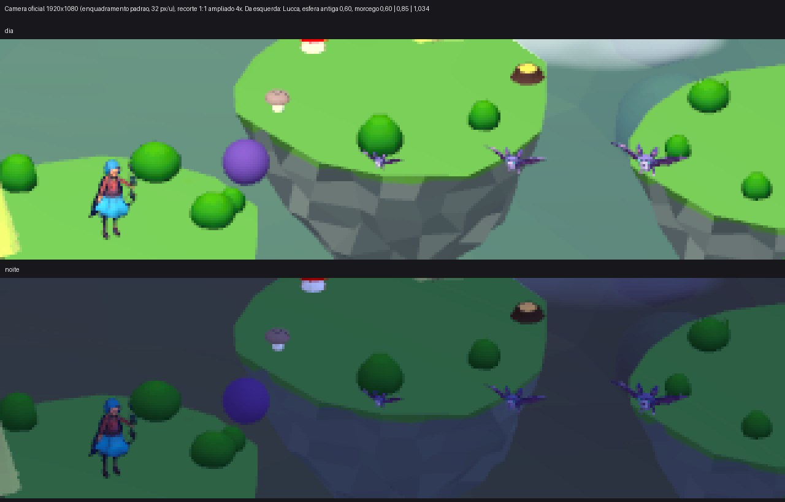

# Sprint 5B — Animação e integração dos inimigos 3D (2026-11-17)

Branch `feature/sprint5b-enemy-animation` a partir da `main` @ `ef78f01` (merge da sprint corretiva de UI, PR #16).
Uma worktree (`loopia-mvp`), um Editor (Unity 6000.3.10f1, URP 17.3, perfil de save `qa-sprint5b`), Blender 5.2.0 LTS.
Entrada: `Loopia_Sprint5_3D_Models_Review_v1.1.zip` (SHA-256 `21cf7a4f…1b512`, 204 arquivos, `testzip` sem erro),
extraído em `Documents\Loopia_Sprint5B\00_Input` (fora de `Assets`).

**Encerramento:** PR #17 mesclado na `main` @ `80488ec` (2026-11-17). Validação final, desempenho na Release e pacote
de distribuição: [SPRINT5B_FINAL_RELEASE.md](../releases/SPRINT5B_FINAL_RELEASE.md).

## Resumo

| Critério | Estado |
|---|---|
| Três modelos v1.1 integrados (GUIDs do pacote preservados) | **Feito** |
| Clipes de produção no Blender (17), fontes editáveis versionadas | **Feito** — `ArtSource/Inimigos/Sprint-5B/` |
| Morcego comum substitui a esfera | **Feito** (`Morcego.asset` → `Bat_Common_Visual`) |
| Morcego Ancião com prefab próprio | **Feito** (`VarianteDoChefe.prefab` + `tamanhoDoVisual`) |
| Lobo animado no NavMeshAgent | **Feito** (`Lobo.asset` → `Wolf_Common_Visual`; `Lobo.prefab` antigo mantido para rollback) |
| Membranas sem deformação inválida nos clipes aprovados | **0 falhas** em 784 amostras + 2 576 Hit aditivo + 4 440 cross-fades |
| Personagens reconhecíveis na câmera oficial | Morcego 18 → **26 px** (critério da Bible ≥ 20 px) |
| Gameplay intacto (dano 1×, recompensas 1×, Revoada, vitória) | Testes de integração verdes — §10; build — §11 |
| Suíte completa | **458/458** (base 445 + 13 novos) — §10; depois da rodada 2: **461/461** em `b8b651f` — §11b |
| Build Windows x64 | Release e Development, 0 erros/0 avisos; 3 jornadas na Release (vitória, derrota, save, reabertura) — §11 |
| Lobo visto na build | Não na build `59cbb7d` (regra da Floresta, §11); regra **corrigida** (§11a) e **visto na Release `b8b651f`**: nasce na Floresta, ataca, é atingido e morre (§11b) |

## 1. Auditoria dos modelos recebidos

Script `ArtSource/Inimigos/Sprint-5B/scripts/auditar_fontes.py` (só lê). Resultado em `Blender/auditoria_v1.1.json`.

| Modelo | Ossos | Malhas (peças) | Vértices pesados | Influências | Modificadores | Ações |
|---|---:|---:|---|---|---|---|
| Bat_Common | 25 | 38 | 2 160 / 2 160, soma 1 | ≤ 4 | só Armature | `QA v1.1 · envelope de voo` (ativa, 1–621), `QA · poses de verificação` |
| Bat_AncientBoss | 26 | 50 | 3 210 / 3 210, soma 1 | ≤ 4 | só Armature | idem |
| Wolf_Common | 36 | 40 | 3 092 / 3 092, soma 1 | ≤ 4 | só Armature | `QA · poses de verificação` (ativa, 1–73) |

- Armature e peças com transform de objeto em identidade, bind pose sem rotação no frame 1, UV única `Atlas`, um
  material por modelo, atlas 1024² embutido; 24 fps; marcadores de QA presentes (Neutral, Up_Max, Dive_Prep,
  Revoada_Raise 351, Revoada_Open 367, Historic_Downstroke 471…).
- Nenhum grupo de vértices sem osso. Orientação da fonte −Y frente / +Z cima confirmada pelos eixos de repouso.
- GUIDs do pacote (3 FBX, 3 PNG, 3 materiais) **livres** no projeto: copiados com os `.meta` originais para
  `Assets/Modelos/Inimigos/<Modelo>/`.

**Nada da geometria, pesos, UVs, materiais ou hierarquia foi alterado.** `produzir.py` calcula um hash de vértices,
pesos, UVs, ossos e materiais antes e depois e aborta se mudar (hashes em `Blender/acoes_de_producao.json`).

## 2. Importação na Unity

| Arquivo | Configuração |
|---|---|
| `<Modelo>.fbx` (entregue, GUID preservado) | Generic, avatar do próprio modelo, **sem clipes**, escala 1, Bake Axis Conversion, Read/Write **desligado** (nada de runtime lê a malha; handoff §4) |
| `<Modelo>_Animacoes.fbx` (novo) | só a armature + clipes; Generic, **Copy From Other Avatar** (o do modelo), **Preserve Hierarchy**, compressão **Off**, Loop Time só nos laços, `Hit` com pose de referência aditiva no 1º quadro |

Tudo é reaplicado por `Loopia > Inimigos > Configurar modelos animados` (`Assets/Editor/InimigosAnimados.cs`).

Importação conferida: três Avatars Generic válidos; um `SkinnedMeshRenderer` por modelo (25/26/36 ossos, `rootBone`
= `Root`); URP/Lit; 3 148 / 4 643 / 4 343 vértices e 4 168 / 6 220 / 6 024 triângulos na Unity; orientação +Z
frente, +Y cima (o pivô do morcego fica na âncora de voo, o do lobo no chão entre as patas).

**Bug encontrado na importação:** o FBX só de animação tem um único nó raiz e a Unity o colapsava, então as curvas
ficavam `Root/Body/...` em vez de `Bat_Common/Root/Body/...` e **não animavam nada** (os bounds medidos saíam iguais
aos de repouso). Corrigido com `preserveHierarchy = true` no importador das animações (teste
`Lacos_PrimeiraEUltimaPoseIguais` falha se os caminhos não baterem: exige movimento).

## 3. Decisões de rig e de produção

- Rigs aprovados usados como estão: nenhum osso, restrição ou peso novo. `Root` nunca é animado (clipes in-place);
  oscilação visual vai em `Body` (morcegos) e `Pelvis` (lobo).
- Comandos de articulação com a **mesma convenção do QA 5A.1** (`wing_motion.apply`): eixo da armature convertido pela
  inversa da rotação de repouso de cada osso, lado `.R` espelhado. Os ângulos do relatório têm o mesmo significado
  dos JSONs de QA recebidos.
- Ações de QA preservadas (fake user, ação ativa ao abrir = a do pacote). As de produção ficam com fake user e como
  faixas NLA silenciadas `PROD <nome>`; nota `LEIA · Sprint 5B` no arquivo.
- Chaves a cada meio frame (48 amostras/s, curvas Bézier), exportadas com o mesmo passo.
- **Morcegos:** batimento com transmissão ombro → cotovelo → punho → dígitos (atrasos 0,06–0,09 / 0,11–0,15 /
  0,17–0,23 do ciclo), descida mais rápida que a subida, dobra da asa na subida, cabeça estabilizada (devolve 75% do
  pitch do corpo), defasagem esquerda/direita e variação de amplitude lentas (asas nunca perfeitamente sincronizadas),
  fecho alternado dos dígitos. Ataque/morte/Hit/Revoada por chaves com spline Catmull-Rom monotônica (sem passar
  dos valores pedidos) e seguimento do punho e dos dedos.
- **Revoada:** `Revoada_Raise` e `Revoada_Open` são **as mesmas poses validadas** dos frames 351 e 367 do QA,
  colocadas em 2,00 s e 2,33 s do clipe; antes delas, agachamento (0,5 s) e subida com tremor das asas.
- **Lobo:** IK auxiliar **analítico no plano sagital** (Upper/Lower em 2 ossos + Ankle com ângulo comandado), escápula/
  quadril em FK, pata pelo pivô dos dedos (toe-off sem afundar), tudo assado em FK. Autoteste: com os alvos no
  repouso o IK reproduz o repouso (erro máx. 0,04°).

## 4. Clipes

| Modelo | Clipe | Quadros @24 | Duração | Laço | Marcos |
|---|---|---:|---:|:-:|---|
| Bat_Common | Idle | 32 | 1,333 s | ✔ | 2 batidas |
| | Fly | 24 | 1,000 s | ✔ | 2 batidas |
| | Attack | 18 | 0,750 s | | antecipação f4, investida f8, **mordida f11 (0,417 s)**, recuperação f14 |
| | Hit (aditivo) | 8 | 0,333 s | | impacto f3 |
| | Death | 24 | 1,000 s | | impacto f3, queda f13 |
| Bat_AncientBoss | Boss_Idle | 48 | 2,000 s | ✔ | 2 batidas |
| | Boss_Fly | 36 | 1,500 s | ✔ | 2 batidas |
| | Boss_Attack | 24 | 1,000 s | | antecipação f7, investida f11, **mordida f14 (0,542 s)**, recuperação f18 |
| | Boss_Hit (aditivo) | 10 | 0,417 s | | impacto f3 |
| | Boss_Death | 42 | 1,750 s | | rugido + asas abertas, colapso f19, queda |
| | Boss_Revoada | 84 | 3,500 s | | preparação f13, **Raise f49 (2,00 s)**, **Open f57**, retorno f65 |
| Wolf_Common | Wolf_Idle | 72 | 3,000 s | ✔ | respiração, olhar, orelhas, cauda |
| | Wolf_Walk | 15 | 0,625 s | ✔ | seq. lateral; **0,989 u/s** do modelo |
| | Wolf_Run | 9 | 0,375 s | ✔ | galope transverso; **4,571 u/s** do modelo |
| | Wolf_Attack | 15 | 0,625 s | | antecipação f3, **mordida f5 (0,167 s)** |
| | Wolf_Hit (aditivo) | 8 | 0,333 s | | só pescoço/cabeça/orelhas/cauda (não move patas) |
| | Wolf_Death | 30 | 1,250 s | | pernas cedem f11, no chão f30 |

Velocidades do lobo calibradas pelo jogo: `NavMeshAgent.speed` = `velocidadeDePerseguicao` 4,5 u/s; escala visual
1,5/1,540 = 0,974 → 4,62 u/s no modelo; galope de 0,375 s com apoio de 21% e passada de 0,36 u dá 4,571 u/s (99%).
A Unity recebe a velocidade real do agente dividida pela escala visual (`Velocidade`) e ajusta o ritmo fora da faixa.

## 5. Validação dos clipes no Blender (os clipes desta sprint, não as ações de teste)

Script `qa_clipes.py`, resultado em `Blender/qa_clipes_producao.json`. Amostras a cada meio frame.

**Morcegos** — método da 5A.1 (BVH das duas membranas fechadas sem pares com vértice comum, interseção entre asas,
normal transportada pela média das rotações de skin, área degenerada < 2% ou < 2·10⁻¹⁰):

| Modelo | Clipes (amostras) | Falhas | Hit aditivo sobre Idle/Fly/Attack(/Revoada) | Cross-fades das transições (nlerp 33%/66%) | Menor cosseno | Menor razão de área |
|---|---|---:|---|---|---:|---:|
| Bat_Common | 5 (217) | **0** | 616 combinações, **0** | 1 008, **0** | 0,631 (Death) | 0,484 (Fly) |
| Bat_AncientBoss | 6 (494) | **0** | 1 960 combinações, **0** | 3 432, **0** | 0,599 (Death) | 0,382 (Fly) |

Ângulo local máximo (graus, maior lado) — dentro do envelope observado na 5A.1:

| | Ombro | Cotovelo | Punho | Dígito 04 | Body |
|---|---:|---:|---:|---:|---:|
| Idle / Fly / Attack (comum) | 34 / 47 / 42 | 14 / 20 / 22 | 7 / 9 / 7 | 11 / 12 / 10 | 5 / 9 / 20 |
| Death (comum) | 53 | 23 | 6 | 10 | 106 (queda) |
| Boss Idle / Fly / Attack / Revoada | 40 / 53 / 50 / 54 | 15 / 21 / 21 / 14 | 7 / 9 / 8 / 8 | 11 / 12 / 10 / 6 | 7 / 11 / 18 / 20 |

**Lobo:** chão = menor z de todas as malhas; deslizamento = |velocidade dos dedos − velocidade do clipe| com o dedo
a menos de 4 mm do chão.

| Clipe | Menor z | Deslizamento médio no apoio | Autointerseção do corpo (repouso = 0) |
|---|---:|---|---:|
| Wolf_Idle | 0,0000 | 0 (patas paradas) | 0 |
| Wolf_Walk | 0,0000 | dianteiras 0,002 u/s (0,2%), traseiras 0 | 4 pares (prega do carpo) |
| Wolf_Run | 0,0000 | 0 / 0,22 u/s (4,9%, só na borda do toe-off) | 39 pares (prega do quadril no galope) |
| Wolf_Attack | 0,0000 | 0 | 0 |
| Wolf_Hit | 0,0000 | — | 0 |
| Wolf_Death | 0,0020 | — | 0 |

Laços: primeira = última chave (diferença 0,0°) e sem quina extra na emenda em todos os 7 laços. Nenhuma troca de
hemisfério de quaternion. IK fora de alcance: 4 amostras da caminhada, ≤ 3,6 mm.

Correções feitas durante a validação (antes de exportar): pivô do toe-off (a pata afundava 1,8 cm no chão), trajetória
do balanço casada com o chão (quina no contato), flexão do carpo no balanço (cotovelo dobrava 87–106°), Hit do lobo
sem rolar o peito (o aditivo movia as patas dianteiras).

## 6. Animator Controllers

Um por família (`Assets/Modelos/Inimigos/<Modelo>/<Modelo>.controller`), parâmetros em português como o resto do
código: `Atacando`, `TempoDoAtaque`, `Dano` (trigger), `Morto`; morcegos `Voando`; chefe `Revoada`, `TempoDaRevoada`;
lobo `Velocidade`, `Ritmo`.

- **Base:** Idle ⇄ Fly (`Voando`) ou Idle ⇄ Locomocao (blend tree 1D Walk 0,989 / Run 4,571 por `Velocidade`,
  velocidade do estado por `Ritmo`); Any State → Attack (`Atacando`), Any State → Death (`Morto`); chefe: Idle/Fly →
  Revoada (`Revoada`), Revoada → Fly ao terminar.
- **Attack e Revoada por motion time** (`TempoDoAtaque`, `TempoDaRevoada`): o componente calcula o tempo do clipe a
  partir dos eventos reais, então a mordida cai no acerto e o Raise cai no `AoUsarEspecial`.
- **Reacao (aditiva, peso 1):** Vazio ⇄ Hit (trigger `Dano`): o impacto soma por cima do voo/ataque sem interrompê-los.

## 7. Código

| Arquivo | Mudança |
|---|---|
| `AnimacaoDoInimigo.cs` (novo) | Visual animado: lê o `Inimigo` e escreve no Animator. Sincronia por motion time, Hit no `AoSofrerDano`, Revoada no `AoAvisarEspecial`/`AoUsarEspecial`, direção visual suave dos voadores (pitch limitado a 35°), **morte destacada** |
| `Inimigo.cs` | `EstaMergulhando`, `Poleiro` (leituras), evento C# `AoSofrerDano`, `AlturaDoPeito` público; `MontarVisual` usa `VisualDeIlha.CriarCriatura` quando o prefab tem `AnimacaoDoInimigo` (esfera/cubo e prefab estático continuam como antes) |
| `VisualDeIlha.cs` | `CriarCriatura`: preserva o pivô do modelo (âncora de voo / chão) e aplica **uma** escala uniforme pelo maior eixo em repouso; plataformas e decoração continuam em `Criar` |
| `VarianteDoChefe.cs` | `prefab` próprio do chefe e `tamanhoDoVisual` (3,0 u) usado só com prefab próprio — sem multiplicar a escala do morcego de novo |
| `InimigosAnimados.cs` (Editor, novo) | Importadores, controllers, prefabs, bounds medidos e ligação dos `InimigoDef`; menu da cena do chefe |
| Dados | `Morcego.asset`: prefab `Bat_Common_Visual`, escala 0,6 → **0,85**; `Lobo.asset`: prefab `Wolf_Common_Visual` |
| Cena `HexPrototipo` | só `EncontroDoChefe.variante.prefab` = `Bat_AncientBoss_Visual` (pelo Editor). Ao salvar, o TMP normalizou 2 textos (`Valor PV`, `Valor Flechas`: a fonte não tem “…”, então o TMP troca Ellipsis → Truncate — o mesmo que já fazia em runtime), o hash de estilo padrão e a cor de 32 bits de 14 textos |

**Nada mudou em:** IA, PV, dano, alcance, cooldowns, velocidades, recompensas, XP, spawn, navegação, condições de
morte/vitória, save. Nenhum Animation Event aplica dano (teste `Clipes_EstaoPresentes…` exige zero eventos).

**Morte.** `Inimigo.ReceberDano` continua destruindo o GameObject no mesmo frame. O `AnimacaoDoInimigo` ouve o
`aoSerDerrotado` (que dispara antes do `Destroy`), se solta (`SetParent(null, true)`), liga `Morto`, toca o Death
num objeto **sem `Inimigo`** e se destrói sozinho (1,0 s de clipe + 0,6 s no chão + 0,25 s encolhendo no morcego).
Voadores caem até o chão da casa (o Ancião cai no máx. 1,5 u: o miolo é oco). Recompensa, lista de vivos e eventos
seguem o fluxo original; o inimigo não fica logicamente vivo para terminar a animação.

**Bugs de integração achados pelos testes e corrigidos:** (1) o `NavMeshAgent` do lobo é criado depois do visual — o
visual guardava `null` e a locomoção nunca saía do Idle; agora a busca é preguiçosa; (2) Any State → Attack/Death
esperava o fim de transições não interrompíveis (até 0,35 s): o componente força a entrada com `CrossFade`;
(3) a morte escrevia `Revoada` em controllers sem esse parâmetro (aviso no console).

## 8. Escala

Comparação na câmera oficial (ortográfica, rotação 30/45/0, enquadramento padrão do anel inteiro: 32 px/u em
1920×1080), dia (12 h) e noite (22 h), mesma semente. Projeção da malha deformada (BakeMesh):

| | Lucca | Esfera antiga 0,60 | Morcego 0,60 | **Morcego 0,85** | Morcego 1,034 |
|---|---|---|---|---|---|
| px (L × A) | 19 × 33 | 19 × 19 | 18 × 8 | **26 × 12** | 31 × 14 |

**Escolha: 0,85 u de envergadura.** A 0,60 o morcego fica abaixo do critério da Scene Bible (“morcego ≥ 20 px”) e
com menos área que a esfera que substitui — cabeça ilegível. A 1,034 fica 1,6× a largura da Lucca: com até 6
morcegos no anel (+ Revoada) e o mergulho chegando ao peito dela, domina a cena. 0,85 lê asa, cabeça e orelhas sem
cobrir a Lucca. Só a escala do visual mudou (colisores e alcance não existem/não mudaram). A tabela da Scene Bible e o
teste `Morcego_TemEscalaDaSceneBible` foram atualizados de 0,5–0,7 para 0,8–0,9 com essa justificativa
(**decisão para revisão**; rollback = voltar `escala` a 0,6 e o intervalo do teste).

Chefe: `tamanhoDoVisual` 3,0 u (modelo 2,970 u; envelope da variante 3,0 u). Sem o campo, 0,85 × 5 = 4,25 u.
Lobo: maior eixo 1,5 (asset inalterado) → 0,93 L de altura, 1,5 de comprimento (Bible 0,8–1,1 / ≤ 1,6).

Capturas: `sprint-5b/escala/` (dia/noite, quadro oficial e close) e `sprint-5b/familias/` (novo × antigo e os três
ao lado da Lucca).

## 9. Bounds e culling

`SkinnedMeshRenderer.localBounds` medido na Unity (espaço do `rootBone`) com `BakeMesh` em todos os clipes a cada
1/48 s, + 8% de margem para o Hit aditivo e cross-fades; `updateWhenOffscreen` desligado; Animator em
`CullUpdateTransforms` (o visual da morte passa a `AlwaysAnimate`).

| Modelo | Centro | Meia-extensão | Repouso importado (meia-extensão) |
|---|---|---|---|
| Bat_Common | (0,011, −0,070, −0,001) | (0,585, 0,551, 0,360) | (0,54, 0,23, 0,26) |
| Bat_AncientBoss | (0,044, −0,024, −0,018) | (1,747, 1,546, 1,079) | (1,61, 0,73, 0,77) |
| Wolf_Common | (−0,175, 0,491, 0,077) | (0,517, 0,544, 0,913) | (0,25, 0,51, 0,81) |

Teste `Limites_DoRendererCobremTodasAsPosesDosClipes` refaz a medida e exige que caiba.

## 10. Testes

Editor 6000.3.10f1, código em `18202ea` (os commits seguintes são só ferramentas/documentação). Save pessoal
`76e429e4…` intacto antes e depois de cada execução (`SaveIsolado` + perfil `qa-sprint5b`).

| Categoria | Resultado | Job / evidência |
|---|---|---|
| Logic + SceneStatic | **417/417** (407 da base + 10 novos) | job `de333471…` (17,1 s) |
| PlayModeSmoke | **37/37** (34 da base + 3 novos) | `sprint-5b/testes/TestResults_PlayModeSmoke.xml` (05:36Z) |
| PlayModeMedicao | **4/4** | `sprint-5b/testes/TestResults_PlayModeMedicao.xml` (05:41Z) |
| **Total** | **458/458** (base 445) | console sem erros nem avisos novos |

Novos (`InimigosAnimadosTests`, Logic): FBX importam (avatar Generic válido, 1 SMR, 25/26/36 ossos, URP);
rigs Generic + Copy From Other Avatar; 17 clipes com duração/laço/24 fps, **sem root motion e sem Animation Event**;
laços sem salto e animando de fato; prefabs com Animator sem root motion, controller e avatar; controllers com
Attack por motion time e camada aditiva; **localBounds cobrem todas as poses**; visuais fora do NavMesh (modifier
`ignoreFromBuild`, sem collider, sem agente); `InimigoDef` com os modelos e os números do GDD intactos; chefe com
`tamanhoDoVisual` sem escala dupla.

Novos (`InimigosAnimadosPlayModeTests`, PlayModeSmoke, na HexPrototipo):
- **Morcego:** nenhuma esfera; envergadura = `escala` (uma normalização); pivô na âncora; o rasante real liga
  `Atacando` e o Animator entra em Attack; a mordida do clipe **nunca** passa antes do acerto e chega em ≤ 0,1 s
  depois dele; **um golpe e um dano por mergulho** (PV cai exatamente `Ataque`); a volta não causa dano; Hit no dano
  não letal; morte: `AoInimigoDerrotado` 1×, XP 1× (dois `ReceberDano` letais seguidos), lista de vivos −1, o
  GameObject de gameplay some no mesmo frame, um visual destacado sem `Inimigo` entra em Death e se destrói.
- **Lobo:** `NavMeshAgent` no GameObject de gameplay, no NavMesh; visual sem agente; anima a locomoção enquanto o
  agente corre (4,5 u/s); cada golpe tem um ataque visual e nenhum dano extra.
- **Chefe:** modelo `Bat_AncientBoss_Mesh` (não herda o do morcego); envergadura 3,0; `Revoada` liga no
  `AoAvisarEspecial`; no `AoUsarEspecial` o clipe está no Raise (±0,06); morte: `AoChefeDerrotado` 1×, vitória 1×,
  partida terminada, visual da morte destacado.

Tudo que o prompt pediu na §14 está coberto: importação (1), Animator (2), Generic (3), clipes (4), laços (5),
sem esfera (6), chefe próprio (7), NavMeshAgent (8), root motion (9), estado de ataque (10), dano 1× (11), sem
recompensa dupla (12), fim de partida (13), culling (14), NavMesh (15), sem erros/exceções (16: o Test Framework
reprova qualquer `LogError`/exceção, e as 40 execuções de Play Mode passaram).

## 11. Build e playtest

Builds Windows x64 (`tools/build/construir.cs`, cenas Acampamento → HexPrototipo), pastas novas, nada sobrescrito:

| Build | Resultado | Tamanho |
|---|---|---|
| `Documents\Loopia_Builds\loopia-sprint5b-59cbb7d-release\` | Succeeded, **0 erros, 0 avisos** | 156 MB |
| `Documents\Loopia_Builds\loopia-sprint5b-59cbb7d-dev\` | Succeeded, **0 erros, 0 avisos** | 220 MB |

Os arquivos que o build regrava (`PC_RPAsset`, `UniversalRenderPipelineGlobalSettings`, `ProjectSettings`,
`TimeManager`) ficaram fora dos commits, como nas sprints anteriores.

**Playtest na Release** com mouse real (computer use), 1920×1080 borderless, perfil `-loopia-perfil qa-sprint5b`
(save `loopia_save_qa-sprint5b.json`; o save pessoal `76e429e4…` não mudou). Capturas da janela por PrintWindow
em `sprint-5b/build/`:

| Jornada | O que aconteceu | Save de QA depois |
|---|---|---|
| 1 | Acampamento → Nova jornada → Torre colocada → morcegos animados no anel (mergulhos, PV 45/50) → 4 voltas → **Morcego Ancião com o modelo próprio** (barra 656/732) e morcegos comuns → **derrota diante do chefe** → Volte ao acampamento | 95 → **121** moedas (+26, igual à tela) |
| 2 | Torre, 2 Corações e 2 Flechas → 4 voltas → chefe com **aviso de Revoada** (disco de perigo, "Revoada" na barra) e **mergulho** do Ancião (sequência `04b`) → **vitória** ("Chefe derrotado — Lucca venceu depois de 4 voltas") → acampamento | **151** moedas (+30), vitórias 10 → **11** |
| — | Fechar o jogo (CloseMainWindow) e reabrir | acampamento mostra **151** e recorde 4 (persistiu) |
| 3 | Torre, Coração, Flechas, Área de Treino e **Floresta** → derrota no chefe | **173** (+22) |

`Player.log` das duas sessões: **0 erros, 0 exceções**, nenhum aviso de parâmetro de Animator.

**Defeito encontrado (pré-existente):** na jornada 3 a carta Floresta não fez nascer o lobo:
`PlataformaFlorestaDef.Povoar` contava **qualquer** inimigo na casa (`InimigoSpawner.QuantosEm`), e havia um morcego
pousado nela (`09_floresta_com_morcego_recorte`). O lobo animado não foi visto na build desta sessão; está validado
no Editor (teste `Lobo_MantemNavMeshAgent_AnimaLocomocaoEAtaqueSemDanoExtra`, capturas `sprint-5b/unity/` e
`familias/`).

### 11a. Correção da Floresta (aprovada pelo responsável depois do playtest)

- `InimigoSpawner.QuantosEm(casa, def)` (novo): conta só os inimigos daquele tipo na casa.
- `PlataformaFlorestaDef.Povoar` repõe até `lobosNaCasa` **lobos** (`QuantosEm(casa, loboQueNasce)`): morcego
  pousado não ocupa mais a vaga. Continua sem empilhar (repõe só o que falta).
- Teste novo `FlorestaPlayModeTests.Floresta_MorcegoPousadoNaCasa_NaoImpedeOLobo_ENaoEmpilha` (PlayModeSmoke):
  morcego na casa → Floresta colocada → 1 lobo; volta fechada → continua 1; lobo morto → a volta seguinte repõe 1.
- **PENDENTE (combinado com o responsável):** rodar a suíte completa e gerar build nova junto com as próximas
  correções. A correção só foi compilada; o teste novo ainda não foi executado, nem a regra antiga para ver o
  vermelho.

FPS/frame time na build: **não medidos** (o jogo não tem contador e o Profiler da build não foi conectado); os números
de custo estão no Editor (§12).

### 11b. Correções pedidas depois do playtest (rodada 2)

Implementadas, testadas (suíte completa abaixo) e com build nova. Evidências em `sprint-5b/correcoes/`.

| Pedido | O que mudou | Commit |
|---|---|---|
| Inimigos muito pequenos | Morcego 0,85 → **1,3** (26 → 40 px na câmera oficial), lobo 1,5 → **1,8**, Ancião 3,0 → **4,5** (`tamanhoDoVisual`, padrão e cena). Só visual. O lobo subiu menos porque morde a 0,52–0,65 u da Lucca e, maior, a cabeça a atravessaria. Scene Bible e testes de escala atualizados | `95619ba` |
| Moedas e corações se atravessando | Com item de carta no centro da ilha, a moeda fica 1,05 u ao lado (direita da tela), inclusive se a carta vier depois; coleta continua por casa | `7f75c62` |
| Lucca corre com o braço esticado | Em Walk/Run o braço do arco (esquerdo) repete o balanço do direito com meio ciclo de defasagem; a pegada fica a do Idle (arco de pé, apontado para baixo). Tiro inalterado. Menu `Loopia/Lucca/Braco do arco acompanha a marcha`. Os `.blend` da 2C.2 continuam com o braço antigo | `2e47f27` |
| Arco girava em torno da mão na marcha | O balanço do braço (até 80° no Run, 27° no Walk) girava o arco junto. A pegada (torção do braço e do antebraço, punho) agora é ajustada quadro a quadro por `HumanPoseHandler` para o `Bow_Grip` manter, no espaço do personagem, a orientação do Idle: desvio medido ≤ 1° nos dois clipes. Capturas `correcoes/lucca_{run,walk}_arco_fixo.jpg` | `681cb71` |
| Arco de pé na corrida (arqueiro carrega deitado) | No Run o alvo da pegada passa a ser o arco deitado: pontas para frente e para trás, no plano horizontal ao lado da perna, lado da flecha voltado para o corpo (Idle girado 90° no eixo lateral e 90° no eixo do arco — a orientação horizontal que o punho alcança dentro dos limites dos músculos; a de flecha para baixo sobrava 45°). Desvio ≤ 1,2°. O Walk (só na aceleração/frenagem; cruzeiro 3,5 = Run puro) mantém o arco de pé. Captura `correcoes/lucca_run_arco_horizontal.jpg` | `20712d6` |
| Miniatura do lobo na carta Floresta | O exportador de miniaturas põe o `Wolf_Common` (pose do Idle) na ilustração; `Floresta_Arte.png` recomposta | `91326e5` |
| Desativar a Mola | `PlataformaDef.desativada`; Mola fora da mão, do sorteio, das recompensas e da colocação. **Consequência de design:** a Ilha Alta, que exige Mola no mapa, deixa de aparecer. A mão inicial passa a Coração, Torre, Flechas + 1 sorteada (antes Mola, Coração, Torre, Flechas). A mecânica da Mola segue no código | `62dbe5d` |

Testes ajustados/novos: `CartasDesativadasTests` (novo), `HudDeCartasInteracaoTests` e `CartasVisuaisTests` (espaço 0
agora é o Coração), `EscalaDeArteSceneTests`, `InimigosAnimadosTests` e `InimigosAnimadosPlayModeTests` (escalas
novas). A primeira rodada do PlayModeSmoke deu 31/38: os 7 testes que exercitam a mecânica da Mola (pulo da Mola,
Mirante e marcador da Ilha Alta) não conseguiam mais colocá-la. A mecânica continua no código, então esses testes
passam a usar uma cópia da Mola em memória com `desativada = false`; o asset não muda (`b8b651f`).

**Suíte completa da rodada 2** (Editor 6000.3.10f1, código em `b8b651f`, perfil `qa-sprint5b`; save pessoal
`76e429e4…` intacto antes e depois):

| Categoria | Resultado | Job / evidência |
|---|---|---|
| Logic + SceneStatic | **419/419** | job `3c528fc5…` (16,9 s) |
| PlayModeSmoke | **38/38** | `sprint-5b/testes/TestResults_PlayModeSmoke_rodada2.xml` (18:42Z) |
| PlayModeMedicao | **4/4** | `sprint-5b/testes/TestResults_PlayModeMedicao_rodada2.xml` (18:47Z) |
| **Total** | **461/461** | console: só os 4 avisos que os testes provocam de propósito (recompensas pendentes, fundo sem modelos, gerador sem mundo, troca de Básica fixa) |

**Builds da rodada 2:** `Documents\Loopia_Builds\loopia-sprint5b-b8b651f-release` (156 MB) e `-dev` (220 MB),
Windows x64, Acampamento + HexPrototipo, **0 erros e 0 avisos**. Release jogada com mouse real
(computer use, tela cheia 1920×1080, perfil `qa-sprint5b`), três jornadas: duas derrotas diante do chefe e uma
interrompida de propósito. Evidências em `sprint-5b/build-rodada2/`:

| O que conferir | Visto na Release `b8b651f` | Captura |
|---|---|---|
| Mola fora do jogo | Mão inicial sem Mola (Coração, Torre, Flechas + 1 sorteada); nenhuma Mola nas recompensas | `01_mao_com_floresta_1080.jpg` |
| Carta Floresta com o lobo | Lobo na ilustração da carta | `02_carta_floresta_com_lobo.jpg` |
| Lobo na Floresta | Nasce ao colocar a carta, anima o Idle, ataca a Lucca, é atingido e morre (cai de lado) | `03_lobo_na_floresta.jpg`, `04_lucca_x_lobo_ataque_e_morte.jpg` |
| Arco da Lucca | Parada: arco de pé. Correndo: arco deitado na altura do quadril, pontas para frente e para trás, sem girar | `05_lucca_correndo_seguida.jpg`, `06_lucca_arco_de_pe_parada_e_deitado_correndo.jpg` |
| Moeda × item da carta | Moeda sorteada na ilha do Coração aparece ao lado do coração, sem atravessá-lo | `07_moeda_ao_lado_do_coracao.jpg` |
| Escala dos inimigos | Ancião com envergadura quase da largura da ilha; lobo do tamanho da Lucca; morcegos maiores que antes | `08_anciao_escala_4_5.jpg`, `03_…`, `04_…` |

Save QA 284 → 314 ao voltar da primeira jornada; save pessoal `76e429e4…` intacto; `Player.log` (81 linhas) sem
erro, exceção ou aviso (`build-rodada2/Player_release_b8b651f.log`). A câmera oficial não aproxima pela roda do
mouse via computer use; os detalhes são recortes ampliados das capturas 1080p.

## 12. Desempenho

**Editor (Play Mode, mesma sessão e mapa, semente 12345, 12 h).** Carga máxima prevista: `maximoDeMorcegos` = 6
morcegos (a Revoada respeita o mesmo teto), 2 lobos e o chefe, nas casas reais do anel, lógica congelada (ninguém
ataca/morre durante a medida) e visuais animando. "Antigo" = esfera (morcego 0,6, chefe 3,0) + `Lobo.prefab`.
`ProfilerRecorder` em ~240 quadros + `FrameTimingManager` + `UnityStats`, **média de 3 repetições**
(`tools/sprint5b/cs/desempenho_*.cs`, bruto em `sprint-5b/desempenho/desempenho_editor.json`):

| Métrica | Antigo | Novo | Δ |
|---|---:|---:|---:|
| Batches / Draw calls | 299,6 / 299,7 | 299,5 / 299,6 | ≈ 0 |
| SetPass | 51,6 | 52,2 | +0,6 |
| Triângulos | 490 928 | 525 710 | +34 782 |
| CPU por quadro (FrameTiming) | 3,85 ms | 4,07 ms | +0,21 ms |
| GPU por quadro (FrameTiming) | 0,40 ms | 0,39 ms | ≈ 0 |
| Main Thread (marcador) | 3,98 ms | 4,32 ms | +0,35 ms (inclui o Editor) |
| `Animators.Update` | 0,053 ms | 0,122 ms | +0,069 ms |
| `DirectorUpdateAnimationBegin` / `End` | 0,030 / 0,039 ms | 0,071 / 0,083 ms | +0,09 ms |
| `MeshSkinning.Update` / `SkinOnGPU` | 0,024 / 0,036 ms | 0,029 / 0,038 ms | +0,007 ms |
| GC alocado por quadro | 24,8 KB | 24,6 KB | ≈ 0 (é o Editor/bridge; o visual não aloca por quadro) |
| Memória gráfica | 444,2 MB | 445,8 MB | +1,6 MB |
| Materiais carregados | 3 299–3 301 | 3 301 | 0 (um material por modelo, `sharedMaterial`) |

Skinning na GPU (URP), um `SkinnedMeshRenderer` e um Animator por inimigo, sem `updateWhenOffscreen`, sem
`MaterialPropertyBlock` (nenhuma variação por instância foi necessária). Nenhum `Camera.Render()` em laço: a
medida não renderiza nada fora do quadro normal.

**Build:** ver §11.

## 13. Evidências

- Blender (geometria real, Workbench com o atlas): pranchas em `sprint-5b/blender/` (vista de jogo, frente e lado do
  lobo com marcas no chão). GIFs completos (todas as vistas) em `Documents\Loopia_Sprint5B\03_Evidencias`.
- Unity (URP, cena oficial, poses avaliadas pelo Animator): pranchas e GIFs em `sprint-5b/unity/`.
- Build (Release, PrintWindow 1920×1080): `sprint-5b/build/` (acampamento, jornada, chefe com morcegos, mergulho do
  Ancião, vitória, derrota, reabertura, recortes) e os `Player.log` das duas sessões.
- Testes: `sprint-5b/testes/` (XML do PlayModeSmoke e do PlayModeMedicao). Desempenho: `sprint-5b/desempenho/`.
- Ferramentas: `tools/sprint5b/` (capturas.py, cs/, montar_gifs.py) — um render por chamada.

## 14. Pendências para polimento

0. **Suíte completa + build nova** com as correções de §11a e §11b; conferir na build o lobo (Floresta), o braço da
   Lucca correndo, as moedas ao lado dos itens e o tamanho dos inimigos.

1. **Prega do quadril no galope** (`Wolf_Run`): até 39 pares de triângulos do corpo se cruzam por dentro da prega
   quando a traseira vai à frente; na caminhada, 4 pares no carpo. Não aparece na câmera do jogo; resolver com
   pesos da anca ou menos flexão do quadril (exige reabrir o skin — fora do escopo desta sprint).
2. **Primeiro golpe do lobo sem antecipação**: a IA golpeia no mesmo frame em que entra no alcance (sem wind-up no
   gameplay); o visual entra 0,06 s antes da mordida. Os golpes seguintes (a cada 2,2 s no alcance) têm a
   antecipação inteira, prevista pelo intervalo do `InimigoDef`. Um wind-up real mudaria o balanceamento.
3. **Rasante sem wind-up no gameplay**: o morcego já se move no frame do `aoComecarRasante`; a antecipação do clipe
   (0,125 s) acontece durante o início do mergulho, não antes.
4. **Morte do Ancião**: o miolo é oco (sem ilha); o visual cai até 1,5 u e encolhe.
5. **Transição Walk ↔ Run**: entre 1 e 4,6 u/s o blend tree mistura caminhada e galope (fases diferentes); o agente
   passa por essa faixa em ~0,15 s (aceleração 30), então só aparece em arrancadas e chegadas.
6. **Hit do lobo** só em pescoço/cabeça/orelhas/cauda (o aditivo não pode mover as patas plantadas).
7. **Limpeza**: `Assets/Modelos/PreFabs/Lobo.prefab`, `Lobo (1).fbx` e `MateusModelos/Morcegp.fbx` ficaram sem uso
   (mantidos para rollback). Remover num PR de limpeza depois da aprovação.
8. **Read/Write desligado** nos FBX: as sondas Unity da 5A.1 (`LoopiaSprint5AImportProbe`) esperavam ligado; religar
   só se elas forem rodadas de novo.
