# Sprint 6 — critérios de render do trabalho (2026-11-23)

Branch `sprint-6/criterios-render` a partir da `main` @ `c305bca`. Um Editor (Unity 6000.3.10f1, pasta
`Github\loopia`), dirigido pelo bridge MCP. O trabalho pede **pelo menos três** destes critérios:

| Critério | Antes | Agora |
|---|---|---|
| 3 shaders via Shader Graph | 1 (`WaterLowPoly`, fora das cenas desde o Pass B) | sem mudança |
| 3 partículas via VFX Graph | 1 (`SmoothSmoke`, morte de inimigo) | **3** |
| Luz baked (lightmaps + light probes) | parcial (LightProbeGroup e LightingData, nenhum lightmap) | sem mudança |
| Luz dynamic com cookie | não havia | **feito** |
| Instanciamento de Decal Projector | não havia | **feito** |

Nada de NavMesh, regra, balanceamento ou save foi alterado. A única cena tocada é a `HexPrototipo` (pelo Editor).

## 1. Luz dinâmica com cookie — sombra das nuvens

- **Onde ver no Inspector:** `HexPrototipo` → `Sun` → componente **Light**: Type Directional, Mode **Realtime**
  (era Mixed sem nenhum lightmap), **Cookie** = `Assets/Arte/Luz/CookieSombraDasNuvens.png`; em *Universal Additional
  Light Data*, Cookie Size 34×34. Componente **Sombra Das Nuvens** (`SombraDasNuvens.cs`) no mesmo objeto.
- Textura 512×512 de ruído fbm que repete sem emenda (gerada por script, ~40% de área sob nuvem, sombra mínima 0,5).
  Importada como *Cookie*, Wrap Repeat, **Alpha from Grayscale**. Sem essa última opção o formato Alpha8 fica com alfa 1
  e o cookie não aparece (o teste `Cookie_ImportadoComAlfaDosTonsDeCinza` guarda isso).
- `SombraDasNuvens.Avancar` anda o `lightCookieOffset` com o vento (0,9; 0,25 u/s) e dá a volta a cada repetição.
- O `Daynightcontroller` continua dono de intensidade, cor e rotação do sol; não mexe no cookie.

| Antes | Depois (sombras de nuvem no relevo e nas ilhas) |
|---|---|
| 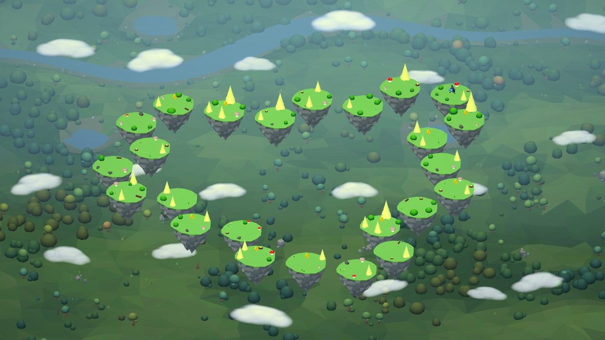 | 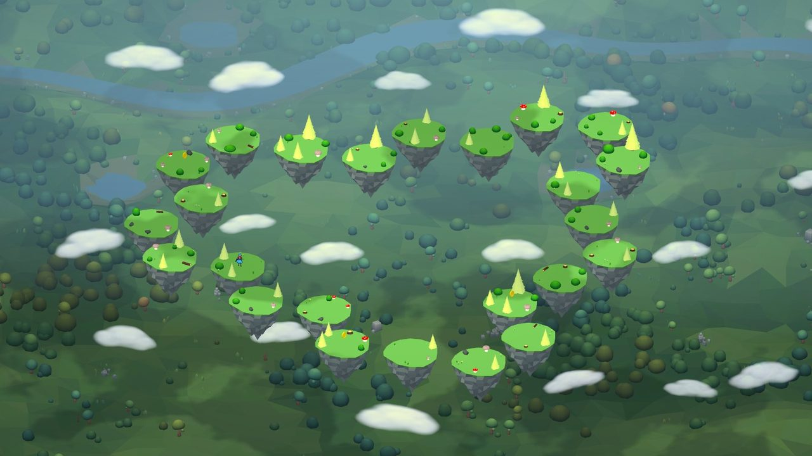 |

## 2. Decal Projector instanciado — marca de fuligem na morte

- `PC_Renderer` ganhou o **Decal Renderer Feature** (técnica Automatic). O `Mobile_Renderer` não foi tocado.
- Prefab `Assets/Modelos/HexPrototype/MarcaDeMorte.prefab`: **DecalProjector** (1,9 × 1,9 × 1,4, material
  `Assets/Arte/Decals/MarcaDeMorte.mat` com o shader URP `Shader Graphs/Decal`) + `MarcaNoChao`.
- `InimigoDef.marcaNoChao` (Lobo e Morcego apontam para o prefab; a variante do chefe herda). Na morte,
  `Inimigo.DeixarMarcaNoChao` acha a ilha sob o inimigo e chama `MarcaNoChao.Criar` → **`Instantiate`** com giro
  aleatório. Sem ilha embaixo (morreu sobre o vazio), não cria.
- `MarcaNoChao` mantém a marca 6 s e apaga em 3 s pelo `fadeFactor`; depois destrói o objeto.

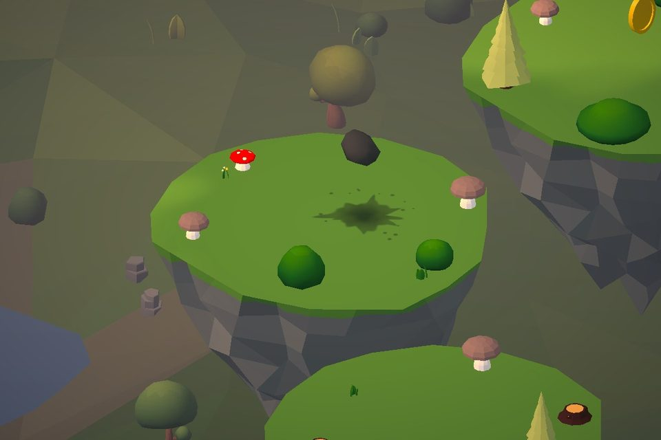

## 3. Três partículas de VFX Graph

| Efeito | Grafo | Estrutura | Onde nasce |
|---|---|---|---|
| Fumaça de morte (já existia) | `VFX e Shaders/SmoothSmoke/SmoothSmoke.vfx` | loop de fumaça | `InimigoDef.efeitoDeMorte` |
| **Brilho da moeda** | `VFX e Shaders/BrilhoDaMoeda/BrilhoDaMoeda.vfx` | rajada (Burst) de 48 faíscas douradas, gravidade e arrasto | `GeradorDeMoedas.efeitoDeColeta` na coleta |
| **Fagulhas da construção** | `VFX e Shaders/FagulhasDaConstrucao/FagulhasDaConstrucao.vfx` | cabeças + rastros (strips por GPU event), fonte dourada | `MapaDePlataformas.efeitoAoColocar` ao colocar carta |

- Os dois novos partem dos templates oficiais do VFX Graph 17.3 (*Simple Burst* e *Heads & Trails*), com
  quantidade, cor, tempo de vida, velocidade, direção, gravidade, tamanho, bounds e capacidade próprios (Heads 13 → 24).
  O script que gerou os valores está em `_Arquivos/Sprint6/previas-nuvens/prototipo/vfx_gerar.py` (fora do git).
- Prefabs em `Assets/Modelos/HexPrototype/` com `VisualEffect` + `EfeitoPassageiro` (toca, para a emissão e se
  destrói). `EfeitoPassageiro.Tocar` não cria nada fora do Play Mode (testes de EditMode não sujam a cena).

| Fagulhas da construção | Brilho da moeda |
|---|---|
| 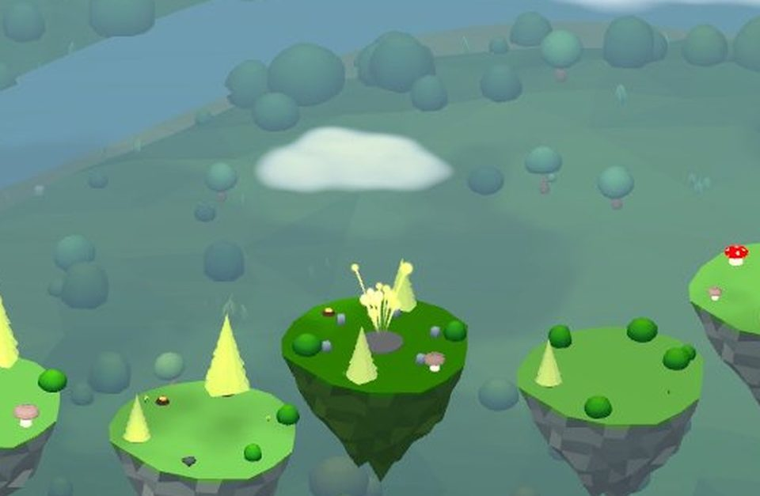 | 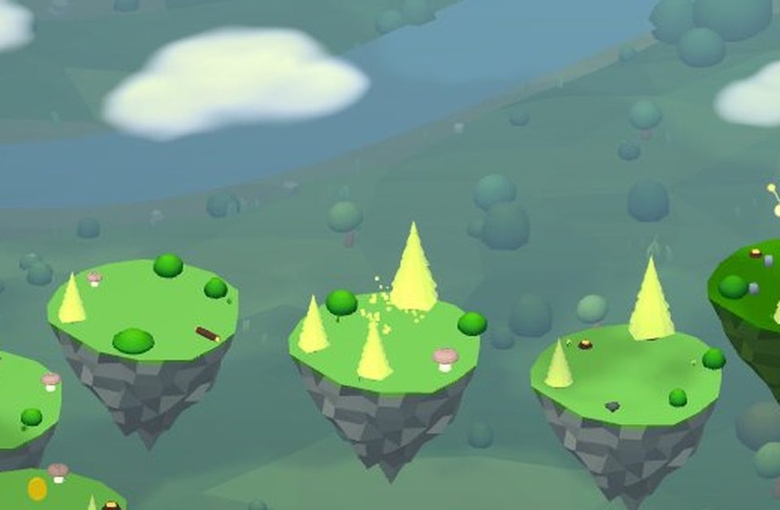 |

## 4. Nuvens toon (escolha do responsável: opção 2, "toon fofa")

As nuvens antigas (`CamadaDeNuvens` + `SoftCloud.shader`, volume por raymarch em billboards) ficavam borradas e
destoavam do relevo low-poly. Quatro protótipos foram renderizados na mesma semente (meio-dia e 18h): 1 low-poly
facetada, 2 toon fofa, 3 pintada 2D, 4 véus de névoa. Fontes e capturas em `_Arquivos/Sprint6/previas-nuvens/`
(fora do git). O responsável escolheu a **2**.

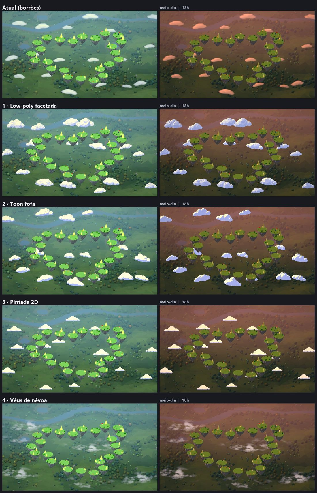

### 4.1 Primeira versão e análise
A primeira versão (6 formatos em fila, branco fixo, luz do sol do jogo) foi analisada a fundo antes de mexer de novo
(folha anotada em `_Arquivos/Sprint6/previas-nuvens/analise_nuvens_toon.jpg`). Principais problemas medidos:
- **Brilho estourado:** 89% dos pixels de nuvem no branco máximo; nuvem 2,4× mais clara que as ilhas; sem
  tonemapping, o canal azul ficava abaixo e o branco virava creme (254, 254, 226); acima de 1,0 ligava o bloom (halo).
- **Sem volume:** o sol (rumo 60°) fica quase atrás da câmera (rumo 45°), então a face visível era toda clara; a sombra
  só aparecia como tira azul na borda de baixo ("adesivo").
- **Forma:** fila de bolas simétrica ("emoji"), dobras sem sombra, faixa toon serrilhada.
- **Composição:** 6 formatos para 16 nuvens com giros parecidos (repetição visível), grade 6×3 incompleta (canto
  superior direito vazio em toda proporção), todas do mesmo porte, mais concentradas sob o anel (10% no terço de baixo).
- **Profundidade:** câmera ortográfica sem sombra das nuvens: não dava para ler a altura (ficam 7–11 u acima do chão).
  A neblina da câmera começa a 105 u e as nuvens estão a ~75 u: misturar neblina não tinha efeito.
- **Movimento:** balanço de ±0,1 u em nuvens de 4–7 u, todas na mesma frequência: deslizavam rígidas.

### 4.2 Versão atual
- **Luz da cena:** a nuvem é iluminada pela mesma luz das ilhas (cor do sol × 0,5 + ambiente do céu × 0,9, medidos em
  12h/18h/22h) e acompanha a hora sozinha: branco-frio ao meio-dia, pêssego às 18h, azul-lavanda às 22h.
- **Volume:** as faixas toon usam uma direção de desenho presa à câmera (de cima, da esquerda e um pouco da frente),
  não o sol; faixa mais suave (0,07), sem serrilha.
- **Teto de brilho** (0,86) que comprime a luminância sem mudar o matiz: nenhum canal estoura e o bloom (limiar 1)
  não pega mais. **Névoa por altura**: quanto mais abaixo das ilhas, mais a nuvem se mistura à cor da neblina
  (dessaturada 35%), o que lê como distância.
- **Malha** (`CriarMalha(random, subdivisões, porte)`): três portes (pequena, média, grande); gomos de base que se
  sobrepõem ~40% do raio, o maior em qualquer ponto da fila; gomos por cima; nas grandes, gomos atrás. Largura
  normalizada em 1. A **cor do vértice R** guarda a abertura (0 nas dobras entre gomos) e o shader joga as dobras na
  sombra. **Faces escondidas** dentro de outros gomos saem: 82–101 mil triângulos para 18–22 nuvens, contra 130 mil
  para 16 antes (~44% menos por nuvem).
- **Composição:** 10 formatos (3 pequenos, 5 médios, 2 grandes por ciclo), 22 nuvens (30% pequenas, 50% médias, 20%
  grandes), largura 0,08–0,24 da vista; giro com o lado comprido de frente (±35°, metade espelhada), porque de ponta
  uma nuvem vira pilha de bolas. Posições iniciais pelo **melhor candidato** (Mitchell) na proporção da tela: sem
  amontoado e sem quadrante vazio, inclusive em 21:9.
- **Profundidade:** as grandes ficam mais fundas (até 2,6 u abaixo) e andam mais devagar (paralaxe); **sombra no chão**
  por um Decal Projector por nuvem (`SombraDaNuvem.mat`, mancha suave, 1,7× a pegada, força 0,85), reta para baixo até
  26 u: escurece 1,3% da tela, ~12/255 em média.
- **Movimento:** balanço proporcional ao tamanho (5% da largura) com frequência própria, "respiração" de ±2,5% e giro
  lento de ±8°. Tudo usa `Time.time`: com `timeScale` 0 para, e o teste de zoom continua valendo.

| Medida (12h, 1600×900, semente 12345) | Toon v1 | Toon v2 |
|---|---|---|
| Pixels de nuvem no branco máximo | 89% | 9% |
| Brilho da nuvem / ilhas | 2,4× | 2,0× |
| Cobertura de tela | 7,8% | 3,7% |
| Quadrantes (sup-esq / sup-dir / inf-esq / inf-dir) | 5 / 4 / 9 / 14% | 3 / 5 / 5 / 2% |

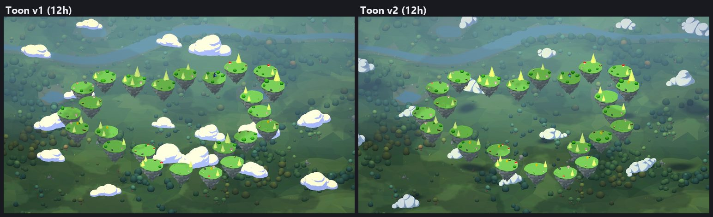
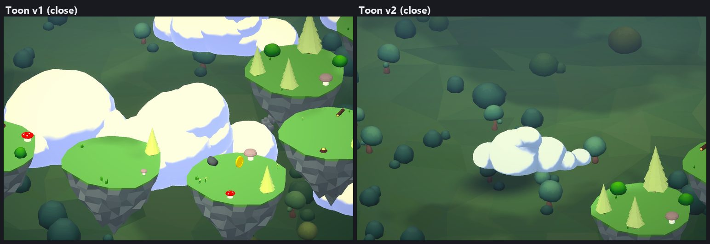
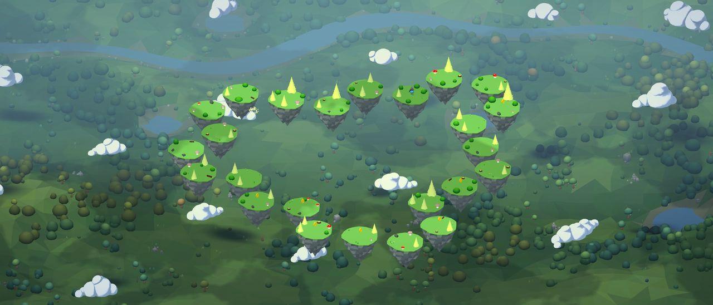

Ciclo do dia com a versão final (zona + vida):

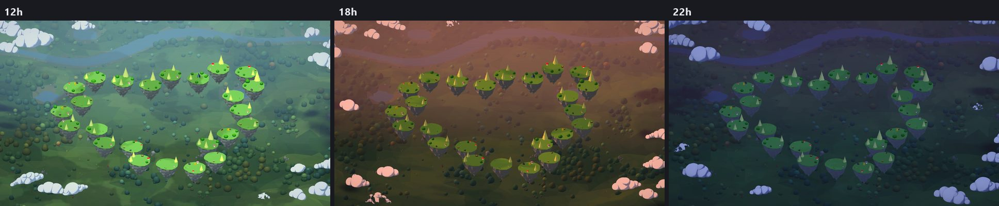

- O `SoftCloud.shader`, o `CloudController` e as 6 `QuadCloud` inativas continuam no projeto (legado, não usados pela
  camada).

### 4.3 Tabuleiro livre e nuvens vivas (pedido do responsável)
Pedido: as nuvens não podem passar por cima das ilhas (distrai o jogador) e precisam se mexer mais: crescer, diminuir,
mudar de forma. Medido antes: o contorno do tabuleiro ocupava 33% da tela 16:9 e 5 nuvens encostavam ou entravam nele.

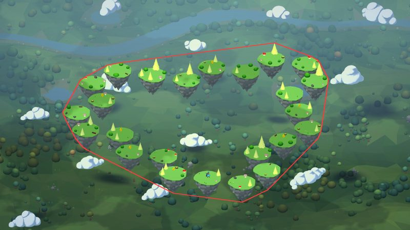

**Composição — zona protegida** (`ComposicaoDasNuvens`, funções puras e testadas):
- A zona é a **envoltória convexa** das caixas de todas as ilhas, projetadas na **vista-base** da câmera (a mesma
  que posiciona as nuvens: zoom e arraste não mudam nada). Inclui o miolo do chefe e os vãos onde se larga carta. Em
  coordenadas de tela (unidade = altura da tela); câmera ortográfica, então o `uv` da nuvem já é a posição dela na tela.
- Recalculada a cada 0,5 s, na hora em que o número de ilhas muda e quando a proporção da janela muda. **Mapa novo**
  (início, outra semente, janela redimensionada): quem ficou dentro é reposicionado na hora. **Ilha nova** por carta
  (fora do caminho, em qualquer casa): quem ficou embaixo se desfaz de mansinho e é empurrado para fora.
- Folga da nuvem = distância do centro até a zona − raio da nuvem na tela (8 cantos da caixa, no tamanho cheio e com
  gomos inchados) − margem (`margemDaZona` 0,04 da altura).
- Perto da zona (`faixaDeDesvio` 0,12) a velocidade perde a parte que entra e ganha um empurrão pela borda
  (`Desviar`): ninguém estaciona de frente. Encostada mais de `tempoMaximoNaBorda` (12 s), a nuvem se desfaz.
- **Moldura equilibrada:** cada nuvem renasce no quadrante mais vazio *em relação à capacidade dele* (quanto cabe de
  nuvem típica fora da zona), com o centro dentro da tela (pode ficar cortada pela borda), fora da faixa de desvio e
  fora da "represa" (lugar cujo caminho com o vento bate no tabuleiro logo em seguida). 20% entram pela borda de onde
  vem o vento, logo depois dela, numa altura em que o caminho reto até o outro lado não cruza a zona. Quem sai inteira
  da tela se afastando renasce. A quantidade ativa segue a área livre (`quantidade` 24 = referência 16:9; 20 na janela
  1,47 do Editor, 30 em 21:9, 19 em 4:3). Deriva lenta (`velocidade` 0,0035): o movimento vem mais da vida da nuvem.
- **Sombra no chão** também some quando cairia dentro da zona.

**Vida:** `Dormindo → Nascendo (6–10 s) → Vivendo (40–90 s) → Dissipando (5–8 s) → renasce` (ou dorme, se a área livre
encolheu), em fases desencontradas. Nascendo, cresce de 55% a 100%, sobe até o lugar e se **materializa com ruído**;
dissipando, encolhe, afunda na névoa e se desfaz com ruído (dissolução por ruído 3D no shader, `_Dissolver` por nuvem,
borda na cor da sombra; vale também nos passes de profundidade).

**Gomos vivos** (`MalhaDeNuvem` + shader): cada vértice leva o centro do gomo (UV2) e (fase, tipo, amplitude,
frequência) (UV3). No vértice, gomos **estáveis** só incham (até +6–14%) e **brotos** recolhem e voltam (de 45–70% a
108%), cada um no seu ritmo, pelo relógio global `_TempoDasNuvens` (tempo do jogo: pausa congela) + fase por nuvem. Faces
escondidas saem só quando estão dentro de um gomo estável com folga maior que o quanto o dono da face pode crescer, e o
centro de cada broto fica dentro do gomo de baixo: nenhuma animação abre buraco. Vento com rajadas lentas (±30%).

| Verificação (Editor 1,47; semente 12345; passos de 0,1 s) | Resultado |
|---|---|
| Pixels de nuvem sobre ilha / dentro do contorno do tabuleiro (render com máscaras, 6 checagens após 3 min) | **0 / 0** |
| Passos com nuvem visível sobre a zona (lógica) | **0** de 5.400 (folga mínima +0,064) |
| Contagem por quadrante, 20 amostras em 10 min (sup-esq/sup-dir/inf-esq/inf-dir) | 97 / 42 / 57 / 66 |
| Renascimentos / desfeitas pela zona | ~20 e ~3 por minuto (vida média ~60 s) |

O canto superior direito fica com menos nuvens porque é a faixa mais estreita entre o tabuleiro e a borda nesse
enquadramento. A medição pegou dois erros meus antes de valerem: a máscara renderizada em 16:9 com o Editor em 1,47
(as nuvens são presas à tela) e o script de máscara religando as nuvens; e mostrou o viés da moldura (nuvens
represadas a montante do tabuleiro e nuvens "invisíveis" fora da tela contando como ocupação), corrigido acima.

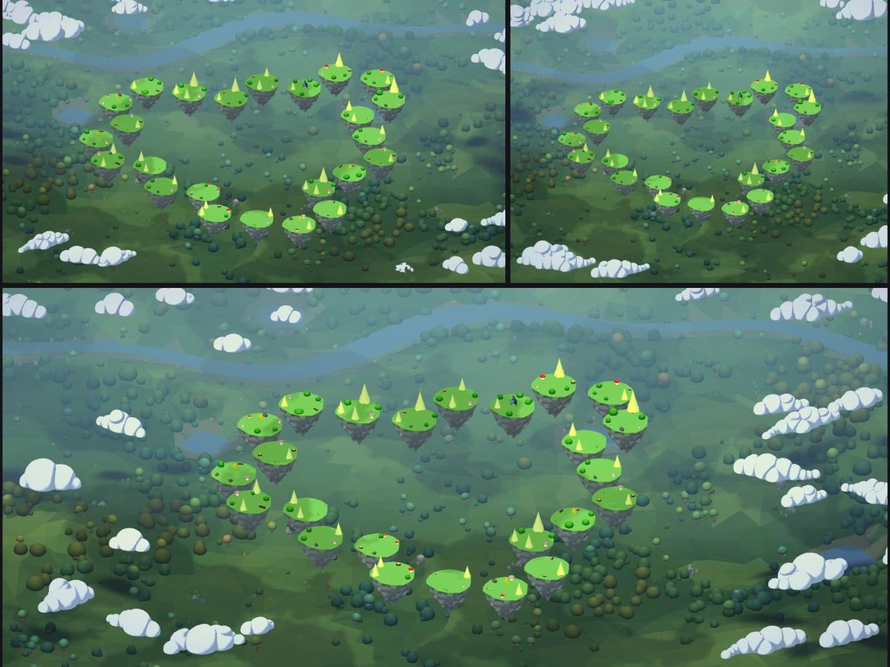
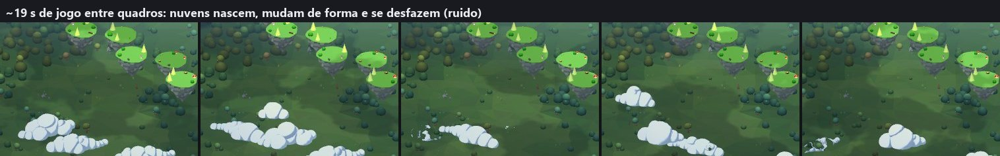

GIFs do movimento (64 quadros, tempo 3×): `_Arquivos/Sprint6/previas-nuvens/nuvens_movimento.gif` e
`nuvens_movimento_close.gif` (fora do git).

### 4.4 Correções pedidas depois (23/11)
**Imagem pixelizada ("MSAA voltou").** Não era o MSAA nem o jogo. Em Play o pipeline ativo é o `PC_RPAsset` (MSAA 4×,
escala 1); medido na Game view: Decal ligado × desligado = 0,00% de pixels diferentes; MSAA 4 × 1 = 4,25% (bordas), ou
seja, o MSAA está agindo e o Decal não interfere. A causa era a **Game view do Editor** com *Low Resolution Aspect
Ratios* ligada, com o Windows em 125% (`pixelsPerPoint` 1,25): o jogo renderizava em 532×359 e era esticado 1,25× até
665×449 físicos. A opção foi desligada na Game view (fica no layout do Editor, não no projeto; a build não é afetada).
Observação: em Play, `QualitySettings.GetQualityLevel()` devolve 0, mas o pipeline usado continua o do PC (conferido em
`QualitySettings.renderPipeline` e `UniversalRenderPipeline.asset`).

**Nuvens "se fundindo" ao nascer.** Em 154 nascimentos simulados, a nuvem nova ficava sobreposta a outra na tela em 66%
do tempo de nascimento (52% atrás/abaixo dela) e as caixas 3D se cruzavam em 56%: como as duas são opacas, a nova
brotava de dentro da vizinha e as duas viravam uma massa só. Causa: o lugar de nascer só *preferia* ficar longe das
outras (e a regra de equilibrar quadrantes empurrava para cantos cheios). Correção: nascer encostada em outra
(distância < 0,9 × soma dos raios) é proibido, também na entrada pela borda; durante a vida, `separacao` afasta devagar
nuvens que se encostam na tela; quem entra pela borda e é empurrada de volta não renasce em laço (só renasce ao sair
quem já apareceu; presa fora da tela por 20 s, renasce); `quantidade` 20. Depois: 0% de sobreposição na tela e 0% de
caixas cruzadas ao nascer; em 20 min simulados a menor distância ao nascer foi 0,789 da soma dos raios (o teste exige
0,7); ~21 renascimentos por minuto; tabuleiro ainda com 0 pixel de nuvem.

## 4.5 Rio com o Shader Graph `WaterLowPoly` (água viva)

O rio do cenário (`Fundo de paisagem/Paisagem (gerada)/Agua`, malha plana gerada pela `FundoDePaisagem`) usava
`Paisagem_Agua.mat` (URP/Lit chapado). O Shader Graph de água do projeto (`VFX e Shaders/Water/WaterLowPoly.shadergraph`
+ `SubgrafhWater`: ondas no vértice, cor por profundidade e espuma pela profundidade da cena) tinha saído da cena no
Pass B junto com o antigo `Rio de fundo` (rio azul saturado sob o anel; maquete com 490 mil triângulos).

Prévia só em Play (sem salvar): **A** = material original do Shader Graph — ciano forte no close, pálido ao meio-dia,
faixa esbranquiçada às 18h (reflexo do sol baixo) e brilhando à noite (saturação 0,63 × 0,46 do atual, 2× o brilho):
descartada. **B** = mesmo Shader Graph na paleta da paisagem — nas três horas fica praticamente igual ao rio chapado na
vista normal (cor e brilho), e no zoom ganha ondas animadas, facetas e cor por profundidade. Escolhida pelo responsável.

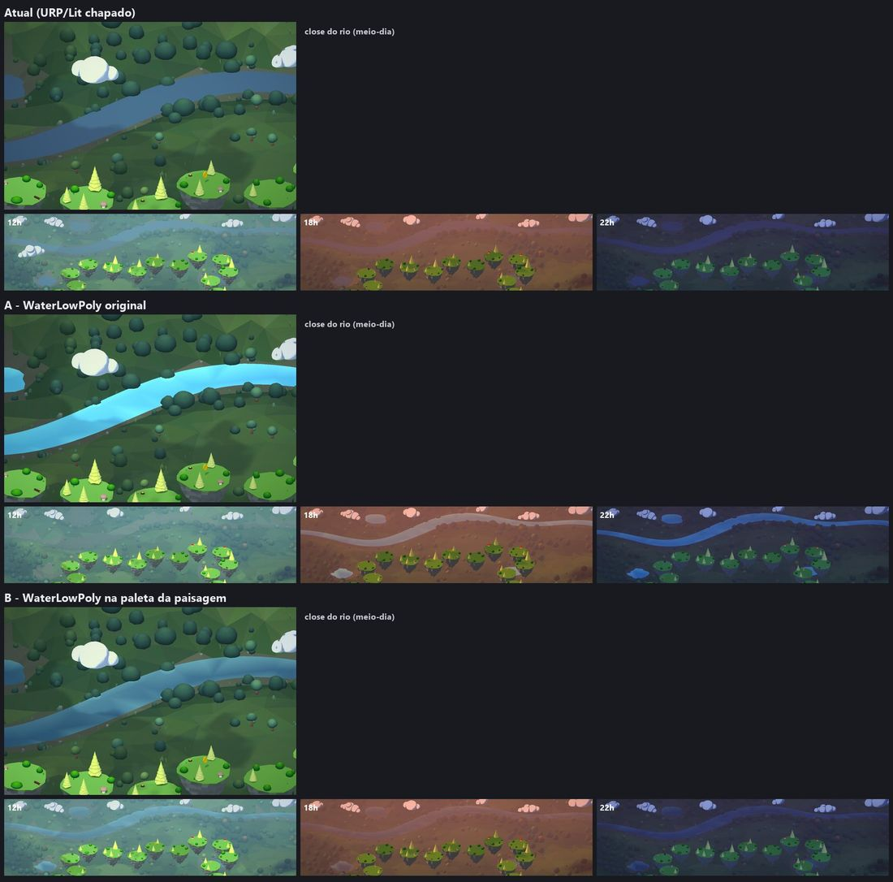

- Novo `Assets/Modelos/Paisagem/Materiais/Paisagem_AguaViva.mat` (Shader Graph `WaterLowPoly`): raso (0,36 0,50 0,52),
  fundo (0,17 0,27 0,33), espuma (0,66 0,74 0,73), brilho 0,35, onda 0,05, profundidade da cor 1,6; velocidade e escala do
  ruído do original. `Paisagem_Agua.mat` continua no projeto (rollback = voltar o campo `agua`).
- `HexPrototipo`: `Fundo de paisagem` → `FundoDePaisagem.agua` = `Paisagem_AguaViva` (único campo mudado, pelo Editor).
- `FundoDePaisagem.cs`: `NovoRenderer` devolve o renderer; a água ganha recorte 0,5 u mais alto (as ondas sobem a malha
  plana no shader).
- O rio fica a ~75–105 u da câmera e o rio ocupa 5% da tela; o shader é transparente e usa a profundidade da cena (já
  ligada no `PC_RPAsset`). Custo não medido na build.

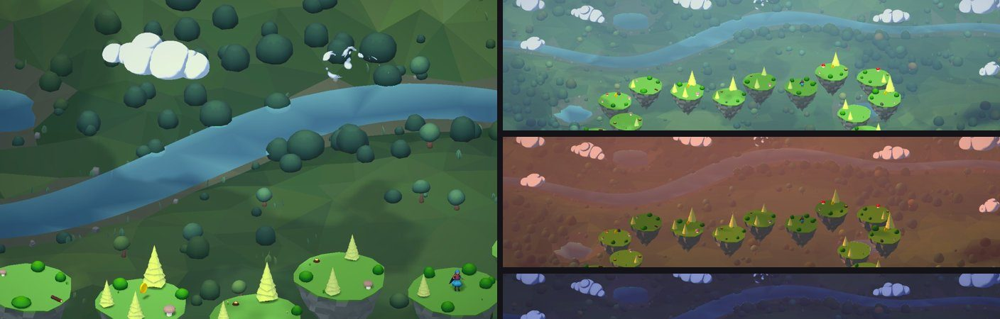

## 5. Arquivos

- Novos: `Assets/Scripts/Hex/{SombraDasNuvens,MarcaNoChao,EfeitoPassageiro,ComposicaoDasNuvens,MalhaDeNuvem}.cs`,
  `Assets/Arte/Luz/CookieSombraDasNuvens.png`, `Assets/Arte/Decals/MarcaDeMorte.{png,mat}`,
  `Assets/Arte/Nuvens/{NuvemToon.shader,NuvemToon.mat,SombraDaNuvem.png,SombraDaNuvem.mat}`,
  `Assets/Modelos/Paisagem/Materiais/Paisagem_AguaViva.mat`,
  `Assets/Modelos/HexPrototype/{MarcaDeMorte,BrilhoDaMoeda,FagulhasDaConstrucao}.prefab`,
  `Assets/VFX e Shaders/{BrilhoDaMoeda,FagulhasDaConstrucao}/*.vfx`, `Assets/Tests/Editor/{CriteriosDeRenderTests,NuvensZonaPlayModeTests}.cs`
  (todos com `.meta`).
- Alterados: `Inimigo.cs`, `InimigoDef.cs`, `VarianteDoChefe.cs`, `GeradorDeMoedas.cs`, `MapaDePlataformas.cs`, `FundoDePaisagem.cs`,
  `CamadaDeNuvens.cs` (reescrita: zona, vida, gomos), `Assets/Dados/{Lobo,Morcego}.asset`, `Assets/Settings/PC_Renderer.asset`,
  `Assets/Scenes/HexPrototipo.unity` (Sun: cookie, Realtime, `SombraDasNuvens`; `efeitoDeColeta` e `efeitoAoColocar`;
  `Camada de nuvens` com o material toon; `FundoDePaisagem.agua` = `Paisagem_AguaViva`).

## 6. Evidências

- Logic + SceneStatic: **435/435** (job `07102386…`, 18,4 s, com a água viva); eram 419, +16 novos em
  `CriteriosDeRenderTests`.
- PlayModeSmoke + PlayModeMedicao: **43/43** (job `a25c4de6…`, com a água viva; inclui
  `Nuvens_NuncaPassamPorCimaDoTabuleiro` e `Zoom_AproximaArrastaEVolta_NuvensFicamPresasAoMundo`; lido pela Unity no
  `TestResults.xml` de 23/11 15:37, porque o rastreador do MCP perde o job no domain reload).
- Console: 0 erros e 0 avisos depois de cada import/compilação.
- Não validado em build.

### Save pessoal — atenção
- O shell dos agentes roda isolado e enxerga **outro** `LocalLow\DefaultCompany\Loopia` (lá o save tem 321 moedas e
  existem os perfis `qa-*`). O arquivo que a Unity lê e grava tem **239 moedas, 1 vitória, recorde 6** (SHA `fdae319a…`,
  gravado 23/11 10:13 pela restauração da suíte, mesmo conteúdo). Backup feito pelo shell não protege o save real:
  fazer backup e hash **pelo `execute_code`** na Unity.
- As capturas desta sprint entraram em Play sem perfil e forçaram 4 coletas de moeda (teste do brilho): o save real
  ganhou **pelo menos +4 moedas**. Vitórias e recorde não mudam por isso. Não foi corrigido: decisão do responsável.

## 7. Pendências

- Build Release com os efeitos e as nuvens novas (custo do Decal em DBuffer com 22 sombras de nuvem + marcas, das
  partículas e dos ~100 mil triângulos de nuvem não medido).
- Correção das +4 moedas no save real (decisão do responsável).
- `ProjectSettings/TimeManager.asset` já vinha modificado antes da sprint; fica fora do commit.
